# CNC Display

Touch-panel firmware for a [FluidNC](https://github.com/bdring/FluidNC) CNC router:
a pendant you mount by the machine and run jobs from. It runs on an
**Elecrow CrowPanel Advance 7.0** (ESP32-S3, 800×480, GT911 touch) with
[LVGL](https://lvgl.io) 8.3, and talks to the controller over a 1 Mbaud UART.
Built for one machine (a FoxAlien Masuter 3S 8040 on a Corgi board with an
OpenATC tool rack), but every control is gated on what the controller's own
config says it has.

<p>
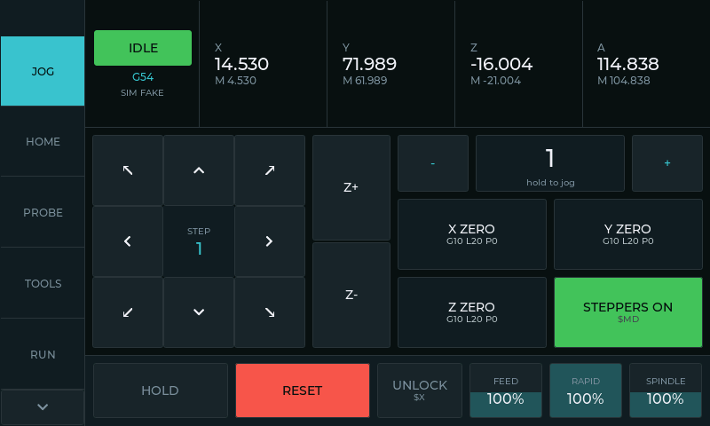
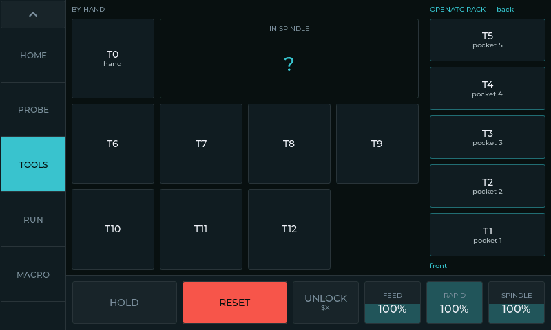
</p>

## What it does

- **DRO and jog** — work and machine position for every axis the controller
  reports; continuous hold-to-jog, step jog, tap an axis to type a target.
- **Homing walk-through** — when position can't be trusted (fresh link,
  controller restart, an alarm that loses position) a card walks you through a
  checklist, HOME ALL, and an optional tool-length measurement.
- **Tool changes** — a TOOLS page laid out like the machine: T0 by hand, T1–T5 in
  the OpenATC rack, T6+ off-rack. Tap a tool, LOAD or CANCEL; FluidNC's M6 macro
  does the rest, and the panel shows a card for every by-hand step. Jobs that
  pause for a tool say *which* tool.
- **Overrides** — feed, rapid and spindle open a full-width slider card.
- **Safety** — HOLD / RESET / UNLOCK on every page, never covered by a popup;
  STEPPERS OFF disarms hard limits so pushing the gantry by hand can't trip a
  reset that silently re-enables the motors.
- **Probe, offsets, macros, run from the controller's SD card, calibration,
  diagnostics** — see the screenshots below.
- **Network update** — the panel fetches its own firmware over Wi-Fi, resuming
  a stalled download.

## Screenshots

All of these are the real UI, rendered by the desktop simulator below.

| | | |
|---|---|---|
| 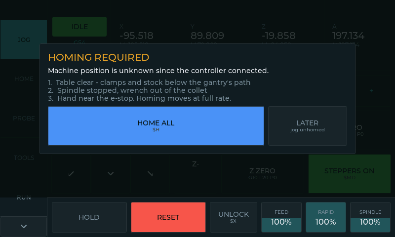 Homing walk-through | 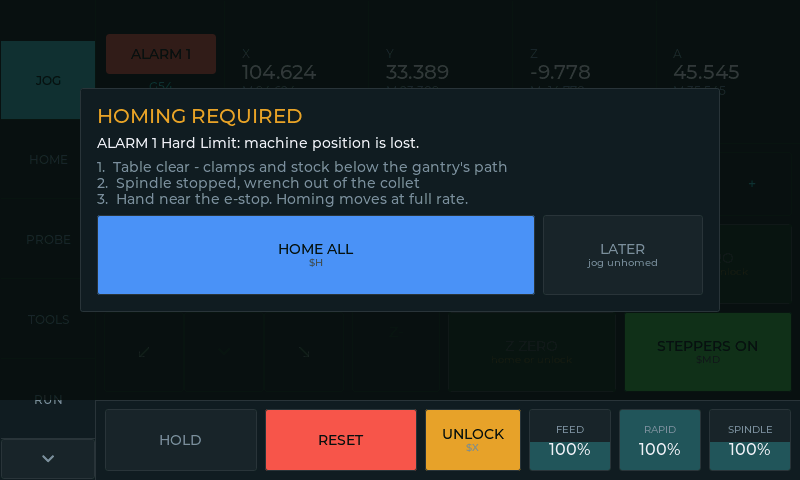 After a hard-limit alarm | 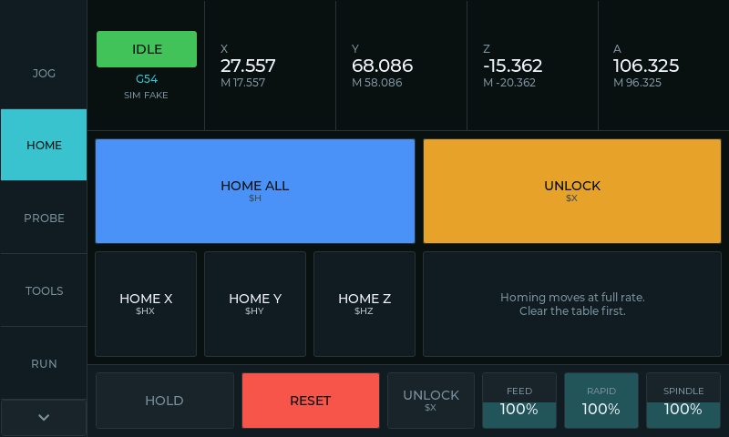 Home |
| 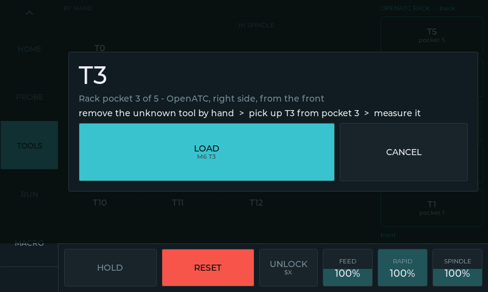 Tap a tool: the plan, LOAD / CANCEL | 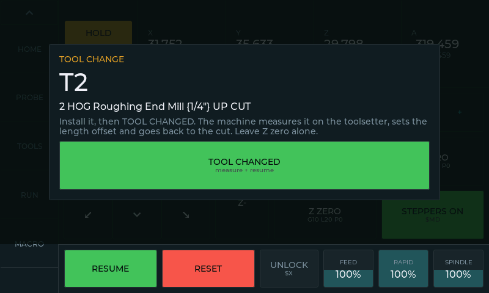 A job paused for a tool |  Tools |
| 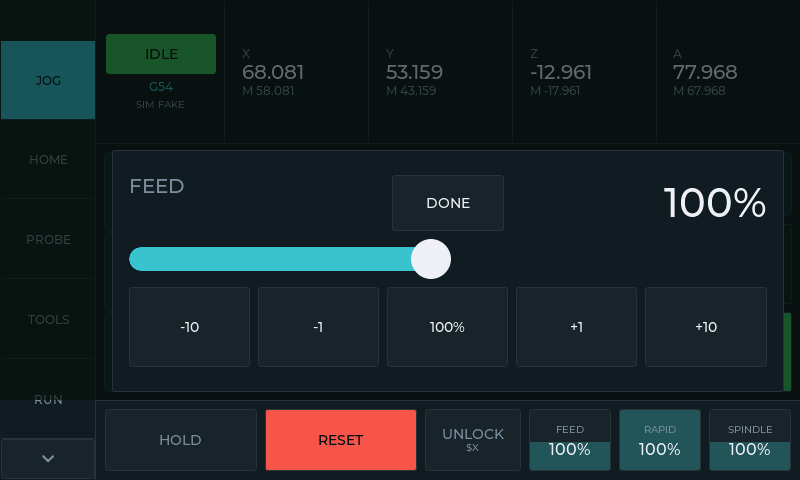 Feed override | 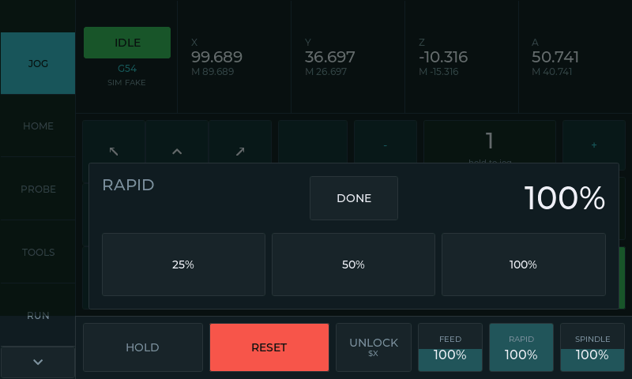 Rapid override | 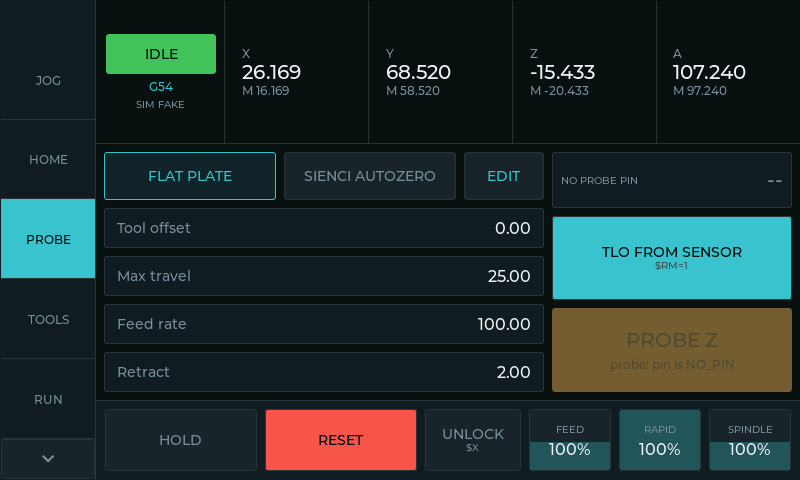 Probe |
| 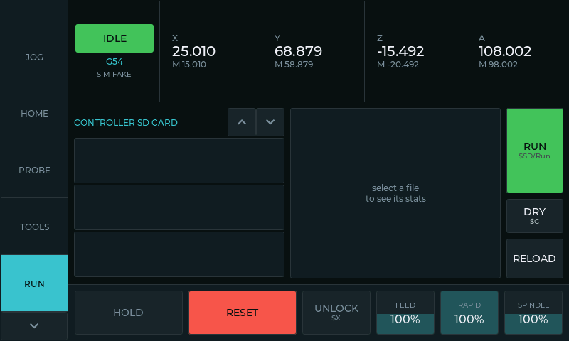 Run (controller SD card) | 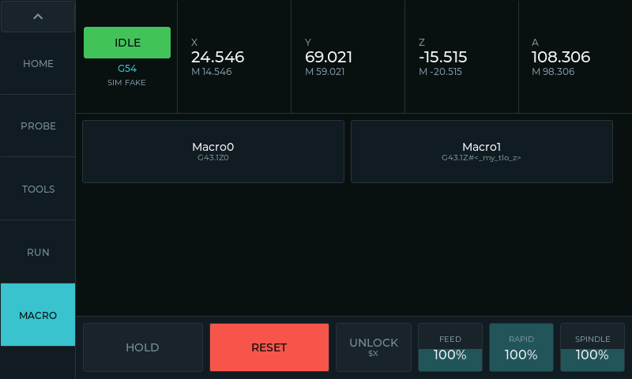 Macros | 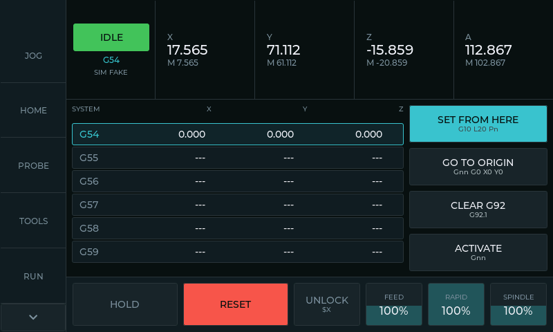 Work offsets |
| 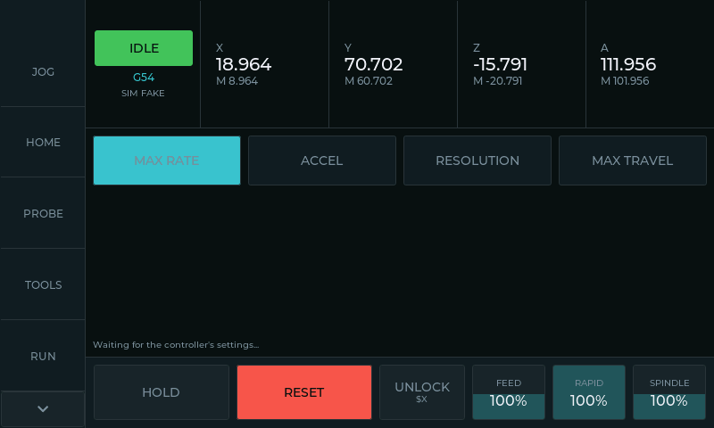 Motion settings | 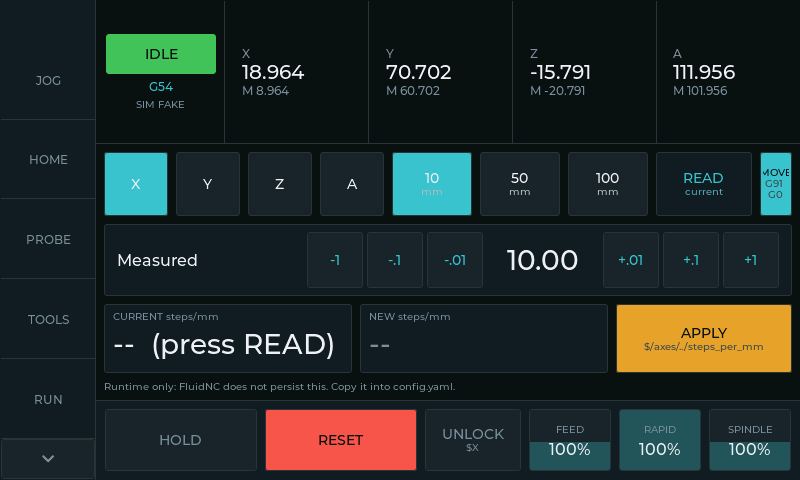 Steps/mm calibration | 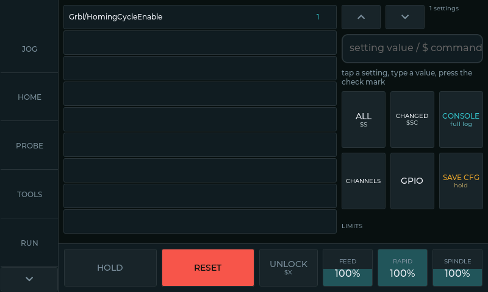 Diagnostics |
| 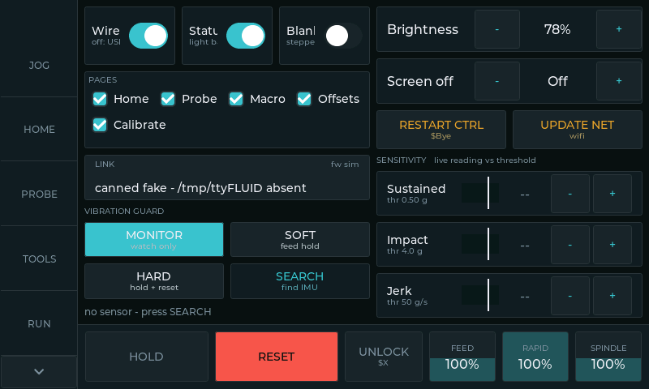 Setup | | |

## Building and flashing

[PlatformIO](https://platformio.org) builds everything:

```bash
pio run -e crowadv                 # the firmware
pio test -e native                 # host unit tests (parsers, models)
```

Flashing: the board's ROM bootloader over USB. `tools/flash.sh` and
`tools/flash_cnc101.sh` are the scripts used here (the latter flashes over SSH
from the PC the panel is plugged into). Once a panel is running, **Setup →
UPDATE NET** updates it over Wi-Fi from the URL in `src/model/settings.cpp`.

**Before building your own:** the Wi-Fi network and update URL defaults in
`src/model/settings.cpp` are this shop's; in the public copy the password and
access token read `REDACTED…`. Put your own in, or the network update has
nothing to connect to.

## Simulators

Two ways to run the real UI on a desktop without the hardware. Both compile
`src/ui` and `src/model` unmodified against SDL2 (needs `libsdl2-dev`).

### Desktop panel (`src/sim`)

The panel in a window, against a built-in fake controller:

```bash
pio run -e sim && .pio/build/sim/program
.pio/build/sim/program --page 10 --shot tools.bmp           # one frame, headless (page index)
.pio/build/sim/program --toolchange 2 --shot card.bmp       # a job pausing for T2
```

Window keys: `1`–`5` force Idle / Run / Hold / Alarm / Jog, `6` plays the next
tool change of a sample job, `space` freezes the DRO, `s` saves a screenshot.
`--tap "x,y;x,y>x2,y2"` scripts touches, which is how the screenshots above were
made. `--link host:port` or `--link /dev/ttyX` drives a real FluidNC instead.

### FluidNC bench (`sim/`)

A fake FluidNC that loads an actual `config.yaml` and derives everything from
it — which axes, which limit and probe pins, whether homing exists — with a web
page to flip inputs and watch the controller:

```bash
make -C sim
./sim/run.sh              # the bring-up profile
./sim/run.sh equipped     # limits, probe, coolant, door, all present
# then open http://127.0.0.1:8080
```

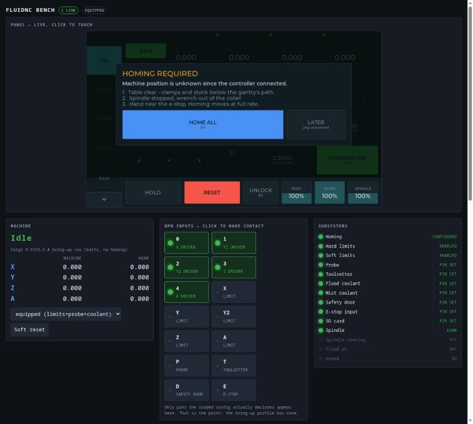

See [`sim/README.md`](sim/README.md) for what is real and what is faked.

## Layout

```
src/ui/        pages, the shell (rail, DRO, safety bar), cards and popups
src/model/     the FluidNC model: state, capabilities, homing, tools, offsets
src/hw/        display, touch, IMU, status LEDs, network update
src/transport/ the UART link and XModem
src/sim/       desktop simulator stand-ins
sim/           FluidNC bench simulator
test/          host unit tests (pio test -e native)
tools/         flashing, config upload, G-code generators
cad/           the panel's mounts and enclosures (FreeCAD)
docs/          engineering notes and handoffs, screenshots
```

The controller side of tool changes — the FluidNC `m6_macro` that drives the
OpenATC rack — lives with the machine's config, not in this repo.

## Credits

The FluidNC model and protocol handling started from Mitch Bradley's
[FluidDial](https://github.com/bdring/FluidDial) (GPLv3, kept in
`FluidDial-main/`), and the parser is his
[GrblParser](https://github.com/MitchBradley/GrblParser).

## License

[GNU General Public License v3.0](LICENSE). This project builds on FluidDial,
which is GPLv3, so the whole is too: you may use, modify and share it, and
anything you distribute that is built from it must be shared under the same
terms, with its source.
